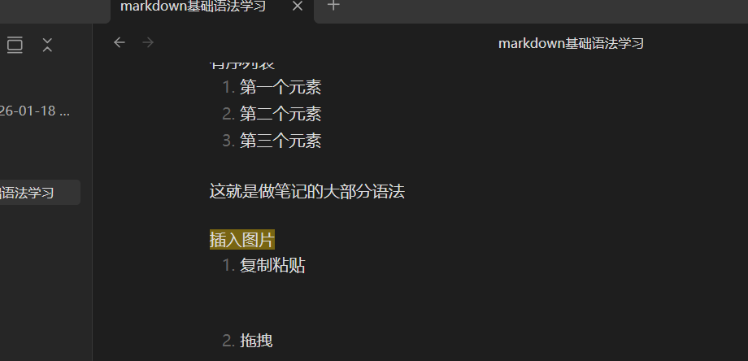
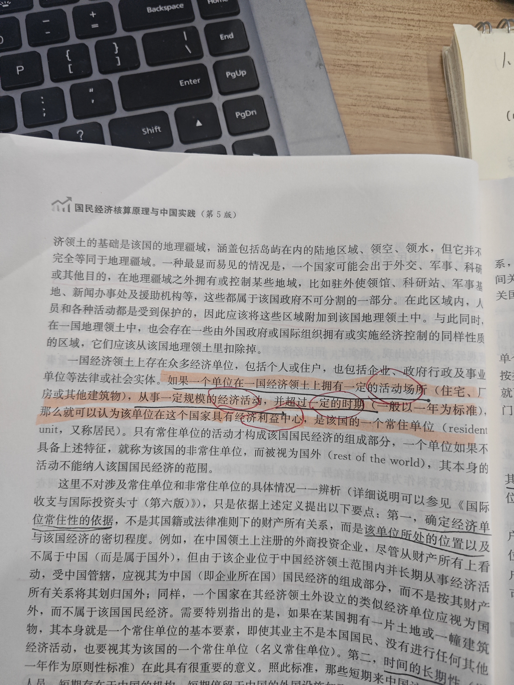

---
tags:
  - 学习语法
---
# 一级标题
## 二级标题
### 三级标题

**这是加粗**

*这是斜体*

~~这是删除线~~

<mark>这是高亮</mark>

`这是内容块`

$\epsilon$

$A_1$

$A^2$

无序列表：
- 这是第一个
- 这是第二个
- 这是第三个

有序列表
1. 第一个元素
2. 第二个元素
3. 第三个元素

这就是做笔记的大部分语法

==插入图片==
1. 复制粘贴

这是一个检测的文件
首先我需要对这个文件进行一个测试

2. 拖拽

标注
>[!NOTE] 我要做一个标注

表格（右键即可插入）

这是一个表格

| column 1 | column 2 |
| :------: | :------: |
|   200    |   100    |

OK,以上就是所有的markdown的语法与内容。

