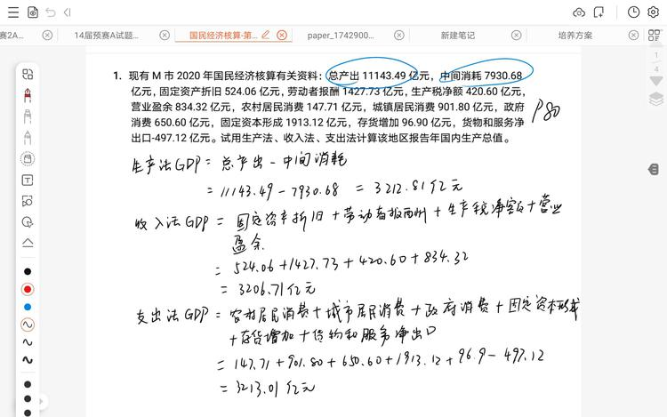
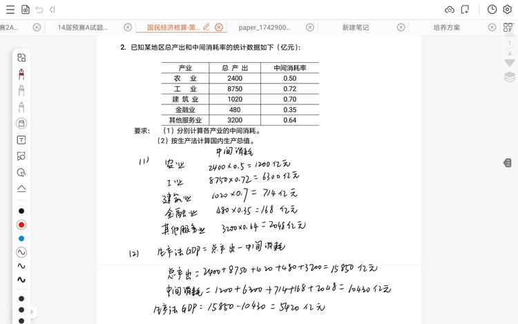
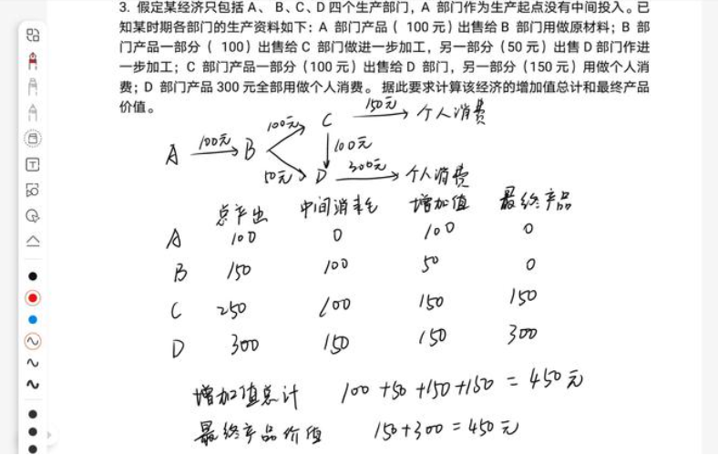
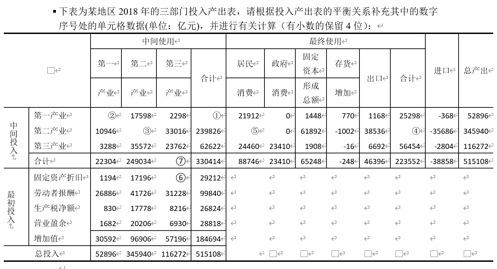

# 第1章课堂练习
https://mooc1.chaoxing.com/mooc-ans/mooc2/work/view?courseId=255607007&classId=128442511&cpi=343104526&workId=45953996&answerId=54305051&enc=b4c1e2e1a5fd6dc6b6216d4d22260e92
## 一. 判断题
1. 在国民经济核算中，一国经济领土就是该国的地理领土。
> [!Check]- 点击查看答案
> 答案：错。经济领土还包括驻外使领馆等，而地理领土内的外国使领馆不属于本国经济领土。 
2. 在我国境内的外国人，都属于我国的非常住单位。
> [!Check]- 点击查看答案
> 答案：错
3. 在国民经济核算中，机构单位和基层单位的含义是相同的，即一个事物的两个不同名称。
> [!Check]- 点击查看答案
> 答案：错
4. 机构单位能够独立拥有资产、承担负债，而有的基层单位不具有这一特征。
>[!Check]- 点击查看答案
> 答案：对
5. 国内生产总值是经济流量指标，资产是经济存量指标。
> [!Check]- 点击查看答案
> 答案：对

# 第二章国内生产总值核算-作业
https://mooc1.chaoxing.com/mooc-ans/mooc2/work/view?courseId=255607007&classId=128442511&cpi=343104526&workId=46720941&answerId=54396539&enc=ba5e033dab7bf4bff84e58958d111011

## 简答题

1. 现有M市2020年国民经济核算有关资料：总产出11143.49亿元，中间消耗7930.68亿元，固定资产折旧524.06亿元，劳动者报酬1427.73亿元，生产税净额420.60亿元，营业盈余834.32亿元，农村居民消费147.71亿元，城镇居民消费901.80亿元，政府消费650.60亿元，固定资本形成1913.12亿元，存货增加96.90亿元，货物和服务净出口-497.12亿元。试用生产法、收入法、支出法计算该地区报告年国内生产总值。

生产法
总产出-中间消耗

收入法
劳动者报酬+固定资本消耗（折旧）+营业盈余+生产经税额

支出法
居民+政府+固定资本形成+存货+净出口

> [!Check]- 点击查看答案
> 答案：

2. 已知某地区总产出和中间消耗率的统计数据如下（亿元）

|  产业   | 总产出  | 中间消耗率 |
| :---: | :--: | :---: |
|  农业   | 2400 | 0.50  |
|  工业   | 8750 | 0.72  |
|  建筑业  | 1020 | 0.70  |
|  金融业  | 480  | 0.35  |
| 其他服务业 | 3200 | 0.64  |

（1）分别计算各产业的中间消耗。
（2）按生产法计算国内生产总值
> [!Check]- 点击查看答案
> 答案：

3. 假定某经济只包括A、 B、C、D四个生产部门，A 部门作为生产起点没有中间投入。已知某时期各部门的生产资料如下：A 部门产品（ 100元）出售给B 部门用做原材料；B 部门产品一部分（ 100）出售给C 部门做进一步加工，另一部分（50元）出售D部门作进一步加工；C 部门产品一部分（100元）出售给D 部门，另一部分（150元）用做个人消费；D 部门产品300元全部用做个人消费。 据此要求计算该经济的增加值总计和最终产品价值。

> [!Check]- 点击查看答案
> 答案：

# 第1-2章小测
https://mooc1.chaoxing.com/mooc-ans/mooc2/work/view?courseId=255607007&classId=128442511&cpi=343104526&workId=46720951&answerId=54396512&enc=48e506faf7dc6f422a5df5c29570ebef

## 一、单选题（共5题）

### 1. (单选题)

国民经济核算是对_____所进行的系统定量描述。

- A.
    
    国民经济活动总体
    
- B.
    
    物质生产活动
    
- C.
    
    非物质生产活动
    
- D.
    
    社会经济活动
    

> [!Check]- 点击查看答案
> 答案：我的答案:_A:国民经济活动总体;_正确答案:_A:国民经济活动总体;

_10_分

_AI讲解_

### 2. (单选题)

下列不属于生产核算范围的是______。

- A.
    
    毒品生产
    
- B.
    
    住户自有住房服务
    
- C.
    
    家务活动
    
- D.
    
    企业自制设备
    

> [!Check]- 点击查看答案
> 答案：_我的答案:_C:家务活动;_正确答案:_C:家务活动;

_10_分

_AI讲解_

### 3. (单选题)

在国民经济范围内，面粉是中间产品，这一命题________。

- A.
    
    对于企业来说是对的
    
- B.
    
    总是错的
    
- C.
    
    当生产单位用作当期生产原材料时才能成立
    
- D.
    
    总是对的
    

> [!Check]- 点击查看答案
> 答案：_我的答案:_C:当生产单位用作当期生产原材料时才能成立;_正确答案:_C:当生产单位用作当期生产原材料时才能成立;

_10_分

_AI讲解_

### 4. (单选题)

支出法计算国内生产总值的公式为

- A.
    
      
    
- B.
    
    国内生产总值=国内总产出-国外总产出
    
- C.
    
    国内生产总值=总消费+总投资+净出口
    
- D.
    
    
    

> [!Check]- 点击查看答案
> 答案：_我的答案:_C:国内生产总值=总消费+总投资+净出口;_正确答案:_C:国内生产总值=总消费+总投资+净出口;

_10_分

_AI讲解_

### 5. (单选题)

在生产过程中所消耗的原材料、燃料属于（  ）

- A.
    
    净产品
    
- B.
    
    总产出
    
- C.
    
    中间产品
    
- D.
    
    最终产品
    

> [!Check]- 点击查看答案
> 答案：_我的答案:_C:中间产品;_正确答案:_C:中间产品;

## 二. 多选题（共3题，30分）

### 6. (多选题)

不同单位在持有一定资产前提下完成的经济活动可以分以下几类（）

- A.
    
    生产
    
- B.
    
    积累
    
- C.
    
    捐赠
    
- D.
    
    分配
    
- E.
    
    消费
    

> [!Check]- 点击查看答案
> 答案：_我的答案:_ABDE:生产; 积累; 分配; 消费;_正确答案:_ABDE:生产; 积累; 分配; 消费;

_10_分

_AI讲解_

### 7. (多选题)

两个机构单位之间的经济交易，根据交易内容可以分为以下几类（）

- A.
    
    收入分配交易
    
- B.
    
    大宗商品交易
    
- C.
    
    知识产权交易
    
- D.
    
    金融交易
    
- E.
    
    货物与服务交易
    

> [!Check]- 点击查看答案
> 答案：_我的答案:_ADE:收入分配交易; 金融交易; 货物与服务交易;_正确答案:_ADE:收入分配交易; 金融交易; 货物与服务交易;

_10_分

_AI讲解_

### 8. (多选题)

我国国民经济核算体系由基本核算和扩展核算组成，其中基本核算包括（）

- A.
    
    资金流量核算
    
- B.
    
    国际收支核算
    
- C.
    
    资产负债核算
    
- D.
    
    投入产出核算
    
- E.
    
    国内生产总值核算
    

> [!Check]- 点击查看答案
> 答案：_我的答案:_ABCDE:资金流量核算; 国际收支核算; 资产负债核算; 投入产出核算; 国内生产总值核算;_正确答案:_ABCDE:资金流量核算; 国际收支核算; 资产负债核算; 投入产出核算; 国内生产总值核算;

_10_分

_AI讲解_

## 三. 填空题（共2题，20分）

### 9. (填空题)

机构单位的特征是能够编制出一套包括（     ）表（四个字）在内的完整的账户。

> [!Check]- 点击查看答案
> 答案：
资产负债

### 10. (填空题)

从价值构成上看，国内生产总值是一国范围内各生产单位当期（  ）（3个字）的总和。

> [!Check]- 点击查看答案
> 答案：
增加值

# 第三章课堂练习
https://mooc1.chaoxing.com/mooc-ans/mooc2/work/view?courseId=255607007&classId=128442511&cpi=343104526&workId=47086043&answerId=54472462&enc=715838c13c6226780b131152912f198b
## 一. 单选题（共4题，50分）

### 1. (单选题)

一家企业主要生产钢铁，同时从事小规模的煤炭开采和炼焦，则在编制投入产出表时该企业创造的总产出应该计入（  ）。

- A.
    
    煤炭开采业
    
- B.
    
    炼焦业
    
- C.
    
    钢铁业
    
- D.
    
    分别计入以上三个产业部门
    

> [!Check]- 点击查看答案
> 答案：_我的答案:_D:分别计入以上三个产业部门;_正确答案:_D:分别计入以上三个产业部门;

### 2. (单选题)

投入产出表第一象限，第三产业行与第一产业列交叉项的数值，从横向上看表示（  ）。

- A.
    
    第一产业部门的产品提供给第三产业部门作为生产消耗使用的数量
    
- B.
    
    第三产业部门在生产过程中消耗第一产业部门的产品数量
    
- C.
    
    第一产业部门在生产过程中消耗第三产业部门的产品数量
    
- D.
    
    第三产业部门的产品提供给第一产业部门作为生产消耗使用的数量
    

> [!Check]- 点击查看答案
> 答案：正确答案:_D:第三产业部门的产品提供给第一产业部门作为生产消耗使用的数量;

### 3. (单选题)

投入产出表第一象限，第三产业行与第一产业列交叉项的数值，从列向上看表示（  ）。

- A.
    
    第一产业部门在生产过程中消耗第三产业部门的产品数量
    
- B.
    
    第三产业部门在生产过程中消耗第一产业部门的产品数量
    
- C.
    
    第一产业部门的产品提供给第三产业部门作为生产消耗使用的数量
    
- D.
    
    第三产业部门的产品提供给第一产业部门作为生产消耗使用的数量
    

> [!Check]- 点击查看答案
> 答案：正确答案:_A:第一产业部门在生产过程中消耗第三产业部门的产品数量;
### 4. (单选题)

在一个三产业投入产出表中，直接消耗系数a21的数值为0.2864，则它所代表的含义是（  ）。

- A.
    
    第二产业生产1单位总产出对第一产业的消耗量
    
- B.
    
    第一产业产品分配给第二产业使用部分所占的比例
    
- C.
    
    第一产业生产1单位总产出对第二产业的消耗量
    
- D.
    
    第二产业产品分配给第一产业使用部分所占的比例
    

> [!Check]- 点击查看答案
> 答案：正确答案:_C:第一产业生产1单位总产出对第二产业的消耗量;

_12.5_分

_AI讲解_

## 二. 多选题（共2题，25分）

### 5. (多选题)

应用投入产出表进行分析的基础一般都是各类投入产出系数，而非各种流量，其原因是各种系数（  ）。

- A.
    
    可以反映出部门间的依赖程度
    
- B.
    
    可以直接反映出由经济技术因素决定的部门投入结构
    
- C.
    
    具有可加性
    
- D.
    
    剔除了部门规模的影响
    
- E.
    
    以上都可以成立
    

> [!Check]- 点击查看答案
> 答案：正确答案:_ABD:可以反映出部门间的依赖程度; 可以直接反映出由经济技术因素决定的部门投入结构; 剔除了部门规模的影响;

_0_分

_AI讲解_

### 6. (多选题)

投入产出表的基本平衡关系有（  ）。

- A.
    
      
    
- B.
    
      
    
- C.
    
      
    
- D.
    
      
    
- E.
    
      
    

> [!Check]- 点击查看答案
> 答案：正确答案:_BDE:; ; ;

_12.5_分

_AI讲解_

## 三. 判断题（共2题，25分）

### 7. (判断题)

第一产业主要包括农林牧渔业，而固定资本一般主要指厂房设备等，所以第一产业产品不会形成固定资产。

- A. 对
- B. 错

> [!Check]- 点击查看答案
> 答案：正确答案:_错

_12.5_分

_AI讲解_

### 8. (判断题)

投入产出核算与国内生产总值核算同属于生产核算的范畴，前者是对后者的进一步延展。

- A. 对
- B. 错

> [!Check]- 点击查看答案
> 答案：正确答案:_对

# 第三章作业
https://mooc1.chaoxing.com/mooc-ans/mooc2/work/view?courseId=255607007&classId=128442511&cpi=343104526&workId=47612713&answerId=54583763&enc=e57d72a7cb85f4d84c4a1a9cd3a003e1
填下面的空并计算直接消耗系数$a_{12},$$a_{23}$（保留四位小数）以及2018年国内生产总值（GDP）

> [!Check]- 点击查看答案
> 答案：①27966 ②8070 ③195864 ④141800 ⑤42374 ⑥10822 ⑦59076
> 直接消耗系数 $a_{12}=0.0509$
> 直接消耗系数 $a_{23}=0.2840$
> 2018年国内生产总值（GDP）$=184694$

> [!EXAMPLE] 习题计算：直接消耗系数
> **题目数据来源**：2018年某地区三部门投入产出表
>
> **1. 计算 $a_{12}$ (第二产业对第一产业的消耗)**
> * 公式：$$a_{12} = \frac{x_{12}}{X_2}$$
> * 代入：$$\frac{17598}{345940} \approx 0.0509$$
>
> **2. 计算 $a_{23}$ (第三产业对第二产业的消耗)**
> * 公式：$$a_{23} = \frac{x_{23}}{X_3}$$
> * 代入：$$\frac{33016}{116272} \approx 0.2840$$
# 第四章作业
https://mooc1.chaoxing.com/mooc-ans/mooc2/work/view?courseId=255607007&classId=128442511&cpi=343104526&workId=47717726&answerId=54604315&enc=c5f39c4188ce9997ea02f31d137fc472
## 一. 单选题（共9题，64分）

### 1. (单选题)

在资金流量核算表中，每个机构部门列出“运用”和“来源”两个栏目，其中前者记录（）

- A.
    
    支出或者资金流出
    
- B.
    
    支出或者资金流入
    
- C.
    
    收入或者资金流出
    
- D.
    
    收入或者资金流入
    

> [!Check]- 点击查看答案
> 答案：正确答案:_A:支出或者资金流出;

_7.1_分

_AI讲解_

### 2. (单选题)

如果一国国民可支配收入大于国民总收入，可能的原因是（ ）

- A.
    
    对国外净劳务输出增多
    
- B.
    
    对外净金融投资规模扩大
    
- C.
    
    来自国外的直接投资扩大
    
- D.
    
    接受来自国外的经常转移
    

> [!Check]- 点击查看答案
> 答案：正确答案:_D:接受来自国外的经常转移;

_7.1_分

_AI讲解_

### 3. (单选题)

国民经济核算是对国民经济运行过程的核算，而国民经济的运行过程是实物循环和（ ）的统一。

- A.
    
    经济循环
    
- B.
    
    生产循环
    
- C.
    
    资金循环
    
- D.
    
    劳动循环
    

> [!Check]- 点击查看答案
> 答案：正确答案:_C:资金循环;

_7.1_分

_AI讲解_

### 4. (单选题)

狭义的资金流量主要是指金融交易流量，广义定义的资金流量则将其范围从金融流量扩大到收入分配流量和（ ），是指整个社会资金的循环过程，体现了与实物循环对应的价值循环。

- A.
    
    收入使用流量
    
- B.
    
    收入消费流量
    
- C.
    
    收入投资流量
    
- D.
    
    收入储蓄流量
    

> [!Check]- 点击查看答案
> 答案：正确答案:_A:收入使用流量;

_7.1_分

_AI讲解_

### 5. (单选题)

资金流量表涵盖了两个基本平衡关系，一个是纵向平衡，即（ ）,反映了每个部门内部收入与支出的来源项目和去向项目,另一个是横向平衡，即交易项目,反映了各种流量的来源部门和去向部门。

- A.
    
    纵向使用平衡
    
- B.
    
    纵向来源平衡
    
- C.
    
    部门内部平衡
    
- D.
    
    部门间平衡
    

> [!Check]- 点击查看答案
> 答案：正确答案:_C:部门内部平衡;

_7.1_分

_AI讲解_

### 6. (单选题)

资金流量表（非金融交易）中收入分配核算的起点是（ ）

- A.
    
    增加值
    
- B.
    
    总产出
    
- C.
    
    净产出
    
- D.
    
    中间投入
    

> [!Check]- 点击查看答案
> 答案：正确答案:_A:增加值;

_7.1_分

_AI讲解_

### 7. (单选题)

各机构部门经过收入初次分配之后获得的生产性收入总额是（ ）

- A.
    
    可支配收入
    
- B.
    
    再分配收入
    
- C.
    
    原始收入
    
- D.
    
    净收入
    

> [!Check]- 点击查看答案
> 答案：正确答案:_C:原始收入;

_7.1_分

_AI讲解_

### 8. (单选题)

资金流量表的主栏按交易项目及平衡项列示，宾栏按（   ）部门列示。

- A.
    
    产业
    
- B.
    
    机构
    
- C.
    
    经济
    
- D.
    
    流量
    

> [!Check]- 点击查看答案
> 答案：正确答案:_B:机构;

_7.1_分

_AI讲解_

### 9. (单选题)

在资金流量表中，非金融企业部门“运用”栏中的“劳动者报酬”数值表示（ ）。

- A.
    
    流入非金融企业的劳动者报酬
    
- B.
    
    非金融企业支付的劳动者报酬
    
- C.
    
    由金融企业流入非金融企业的劳动者报酬
    
- D.
    
    由非金融企业流入金融企业的劳动者报酬
    

> [!Check]- 点击查看答案
> 答案：正确答案:_B:非金融企业支付的劳动者报酬;

_7.2_分

_AI讲解_

## 二. 多选题（共4题，28.8分）

### 10. (多选题)

我国资金流量核算区分为（ ）和（ ）。

- A.
    
    非金融交易核算
    
- B.
    
    金融交易核算
    
- C.
    
    生产核算
    
- D.
    
    非生产核算
    
- E.
    
    存量核算
    

> [!Check]- 点击查看答案
> 答案：正确答案:_AB:非金融交易核算; 金融交易核算;

_7.2_分

_AI讲解_

### 11. (多选题)

收入初次分配主要依据各要素对生产的贡献所进行的分配，初次分配项目主要包括（ ）

- A.
    
    劳动报酬
    
- B.
    
    生产税净额
    
- C.
    
    营业盈余
    
- D.
    
    财产收入
    
- E.
    
    经常性转移收入
    

> [!Check]- 点击查看答案
> 答案：正确答案:_ABCD:劳动报酬; 生产税净额; 营业盈余; 财产收入;

_7.2_分

_AI讲解_

### 12. (多选题)

下列属于收入再分配环节交易项目的是（ ）。

- A.
    
    所得税
    
- B.
    
    生产税净额
    
- C.
    
    社会保障与福利
    
- D.
    
    社会救济
    
- E.
    
    财产收入
    

> [!Check]- 点击查看答案
> 答案：ACD:所得税; 社会保障与福利; 社会救济;

_7.2_分

_AI讲解_

### 13. (多选题)

下列关于可支配收入的表达式，正确的是（ ）

- A.
    
    可支配收入=原始收入+经常性转移收入-经常性转移支出
    
- B.
    
    可支配收入=原始收入+经常性转移收支差额
    
- C.
    
    可支配收入=原始收入-生产税净额
    
- D.
    
    可支配收入=原始收入-所得税
    
- E.
    
    可支配收入=增加值-生产税净额
    

> [!Check]- 点击查看答案
> 答案：AB:可支配收入=原始收入+经常性转移收入-经常性转移支出; 可支配收入=原始收入+经常性转移收支差额;

_7.2_分

_AI讲解_

## 三. 填空题（共1题，7.2分）

### 14. (填空题)

已知企业增加值180亿元，支付劳动报酬60亿元，支付生产税10亿元，政府生产补贴0.2亿元，上缴政府所得税30亿元，支付财产收入（包括分红、利息等）20亿元，补贴医疗、食堂、学校等非物质生产部门5亿元，支援灾区捐款0.1亿元，国库券兑现收入10亿元，利息收入1.3亿元。则企业部门的原始收入= ________亿元，可支配收入=________亿元。

> [!Check]- 点击查看答案
> 答案：(1)91.5 (2)56.4

# 第四章小测
https://mooc1.chaoxing.com/mooc-ans/mooc2/work/view?courseId=255607007&classId=128442511&cpi=343104526&workId=48611975&answerId=54893027&enc=fd44478b1d29e39c1b64c73007e089ca
## 一. 单选题（共6题，60分）

### 1. (单选题)

如果一国国民可支配收入大于国民总收入，可能的原因是（ ）

- A.
    
    对国外净劳务输出增多
    
- B.
    
    对外净金融投资规模扩大
    
- C.
    
    来自国外的直接投资扩大
    
- D.
    
    对国外的经常转移净收入为正
    

> [!Check]- 点击查看答案
> 答案：D:对国外的经常转移净收入为正;

### 2. (单选题)

资金流量表涵盖了两个基本平衡关系，一个是纵向平衡，即（ ）,反映了每个部门内部收入与支出的来源项目和去向项目,另一个是横向平衡，即交易项目,反映了各种流量的来源部门和去向部门。

- A.
    
    纵向使用平衡
    
- B.
    
    纵向来源平衡
    
- C.
    
    部门内部平衡
    
- D.
    
    部门间平衡
    

> [!Check]- 点击查看答案
> 答案：正确答案:_C:部门内部平衡;

### 3. (单选题)

资金流量表（非金融交易）中收入分配核算的起点是（ ）

- A.
    
    增加值
    
- B.
    
    总产出
    
- C.
    
    净产出
    
- D.
    
    中间投入
    

> [!Check]- 点击查看答案
> 答案：正确答案:_A:增加值;

### 4. (单选题)

各机构部门经过收入初次分配之后获得的生产性收入总额是（ ）

- A.
    
    可支配收入
    
- B.
    
    再分配收入
    
- C.
    
    原始收入
    
- D.
    
    净收入
    

> [!Check]- 点击查看答案
> 答案：正确答案:_C:原始收入;

### 5. (单选题)

资金流量表的主栏按交易项目及平衡项列示，宾栏按（   ）部门列示。

- A.
    
    产业
    
- B.
    
    机构
    
- C.
    
    基层
    
- D.
    
    经济  
    

> [!Check]- 点击查看答案
> 答案：正确答案:_B:机构;

### 6. (单选题)

对一国或一个经济体来说，当期国民可支配收入在用于最终消费后，如果其储蓄和投资不相等，就需要通过（　）来调剂。

- A.
    
    非金融交易
    
- B.
    
    金融交易
    
- C.
    
    黄金储备
    
- D.
    
    国际储蓄资产交易
    
> [!Check]- 点击查看答案
> 答案：正确答案:_B:金融交易;

## 二. 多选题（共2题，20分）

### 7. (多选题) 
收入初次分配主要依据各要素对生产的贡献所进行的分配，初次分配项目主要包括（  ）

- A.
    
    劳动报酬
    
- B.
    
    生产税净额
    
- C.
    
    营业盈余
    
- D.
    
    财产收入
    
- E.
    
    经常性转移收入
    

> [!Check]- 点击查看答案
> 答案：正确答案:_ABCD:劳动报酬; 生产税净额; 营业盈余; 财产收入;

_10_分

_AI讲解_

### 8. (多选题)

下列关于可支配收入的表达式，正确的是（ ）

- A.
    
    可支配收入=原始收入+经常性转移收入-经常性转移支出
    
- B.
    
    可支配收入=原始收入+经常性转移收支差额
    
- C.
    
    可支配收入=原始收入-生产税净额
    
- D.
    
    可支配收入=原始收入-所得税
    
- E.
    
    可支配收入=增加值-生产税净额

> [!Check]- 点击查看答案
> 答案：正确答案:_AB:可支配收入=原始收入+经常性转移收入-经常性转移支出; 可支配收入=原始收入+经常性转移收支差额;

## 三. 填空题（共2题，20分）

### 9. (填空题)

非金融投资是指各机构单位间进行的（  ）资产交易。

> [!Check]- 点击查看答案
> 答案：
非金融
### 10. (填空题)

在资金流量非金融交易核算中，储蓄指（  ）收入用于消费后的余额。
> [!Check]- 点击查看答案
> 答案：
可支配

# 第五章小测
https://mooc1.chaoxing.com/mooc-ans/mooc2/work/view?courseId=255607007&classId=128442511&cpi=343104526&workId=48703273&answerId=54925961&enc=79d9c7511dd0ef6cfecefda46034b0a5
## 一. 单选题（共3题，17.4分）

### 1. (单选题)

狭义的资金流量主要是指金融交易流量，广义定义的资金流量则将其范围从金融流量扩大到收入分配流量和（ ），是指整个社会资金的循环过程，体现了与实物循环对应的价值循环。

- A.
    
    收入使用流量
    
- B.
    
    收入消费流量
    
- C.
    
    收入投资流量
    
- D.
    
    收入储蓄流量
    

> [!Check]- 点击查看答案
> 答案：正确答案:_A:收入使用流量;

_5.8_分

_AI讲解_

### 2. (单选题)

以下不涉及金融交易的是（　）

- A.
    
    房产的买卖
    
- B.
    
    购买人身保险
    
- C.
    
    企业向劳动者支付报酬
    
- D.
    
    股价下跌导致市值的损失
    

> [!Check]- 点击查看答案
> 答案：_D:股价下跌导致市值的损失;

_5.8_分

_AI讲解_

### 3. (单选题)

下列说法中，不正确的是（　）

- A.
    
    贷款是金融机构的资产、借款人的负债
    
- B.
    
    通货是发行机构的负债，持有者的资产
    
- C.
    
    证券是持有者的资产，发行人的负债
    
- D.
    
    保险专门准备金是保险公司的资产
    

> [!Check]- 点击查看答案
> 答案：正确答案:_D:保险专门准备金是保险公司的资产;

_5.8_分

_AI讲解_

## 二. 多选题（共4题，23.6分）

### 4. (多选题)

下列情况中可以引起机构单位净金融投资变化的是(    )

- A.
    
    用银行存款购买股票
    
- B.
    
    企业产品销售中形成的应收款项
    
- C.
    
    住户按揭购买汽车
    
- D.
    
    企业提取固定资产折旧
    
- E.
    
    用银行存款购买住房
    

> [!Check]- 点击查看答案
> 答案：BCE:企业产品销售中形成的应收款项; 住户按揭购买汽车; 用银行存款购买住房;

_5.9_分

_AI讲解_

### 5. (多选题)

金融资产和非金融资产的区别在于(    )。

- A.
    
    金融资产常常与金融负债对称存在
    
- B.
    
    非金融资产所有者是通过在生产过程中直接使用非金融资产创造利润而获益，金融资产所有者则是通过分享其他单位的生产成果而获益
    
- C.
    
    融资产是无形的而非金融资产则是有形的
    
- D.
    
    金融资产有所有权和收益权
    
- E.
    
    作为一种无形的权利，金融资产必须借助于一些有形的载体而存在
    

> [!Check]- 点击查看答案
> 答案：正确答案:_AB:金融资产常常与金融负债对称存在; 非金融资产所有者是通过在生产过程中直接使用非金融资产创造利润而获益，金融资产所有者则是通过分享其他单位的生产成果而获益;

_5.9_分

_AI讲解_

### 6. (多选题)

金融资产所具有的性质包括(    )。

- A.
    
    与负债的对称性（货币黄金除外）
    
- B.
    
    具有明确的所有权
    
- C.
    
    收益性
    
- D.
    
    可流通性
    
- E.
    
    可转让性
    

> [!Check]- 点击查看答案
> 答案：正确答案:_ABCDE:与负债的对称性（货币黄金除外）; 具有明确的所有权; 收益性; 可流通性; 可转让性;

_5.9_分

_AI讲解_

### 7. (多选题)

下列情况中可以引起机构单位净金融投资变化的是(    )

- A.
    
    用银行存款购买股票
    
- B.
    
    企业产品销售中形成的应收款项
    
- C.
    
    住户按揭购买汽车
    
- D.
    
    企业提取固定资产折旧
    
- E.
    
    用银行存款购买住房
    

> [!Check]- 点击查看答案
> 答案：BCE:企业产品销售中形成的应收款项; 住户按揭购买汽车; 用银行存款购买住房;

_5.9_分

_AI讲解_

## 三. 填空题（共4题，23.6分）

### 8. (填空题)

根据对称性，金融资产对应着（  ），从交易者来说，即（  ）对应着债务人。

> [!Check]- 点击查看答案
> 答案：
金融负债
债权人

_AI讲解_

### 9. (填空题)

金融交易是指涉及机构单位之间（  ）资产所有权转移的所有交易。
> [!Check]- 点击查看答案
> 答案：
金融

_AI讲解_

### 10. (填空题)

引起金融资产所有权变化的交易有两类:货币性实物交易和严格的（  ）,在第二类交易中，机构单位之间交易的对象不涉及实物，而只限于金融资产。

> [!Check]- 点击查看答案
> 答案：
金融交易

_AI讲解_

### 11. (填空题)

资金流量表（金融交易）上记录了机构部门通过金融交易在核算期内获得的金融资产、发生的金融负债，二者相减，结果称为（  ）。
> [!Check]- 点击查看答案
> 答案：
净金融投资

_AI讲解_

## 四. 判断题（共6题，35.4分）

### 12. (判断题)

资金流量表的金融交易部分是一个二维矩阵结构的平衡表，每个机构都包括运用和来源两列，运用方（左方）记录负债的净增加，来源方（右方）记录金融资产的净增加。

- A. 对
- B. 错

> [!Check]- 点击查看答案
> 答案：正确答案:_错

_5.9_分

_AI讲解_

### 13. (判断题)

土地地下资产属于金融资产。

- A. 对
- B. 错

> [!Check]- 点击查看答案
> 答案：错

_5.9_分

_AI讲解_

### 14. (判断题)

纯粹的金融交易（区别于以货币为媒介的实物交易），不影响净金融投资水平。

- A. 对
- B. 错

> [!Check]- 点击查看答案
> 答案：对

_5.9_分

_AI讲解_

### 15. (判断题)

非金融交易中资金来源与资金运用的差额最终表现为非金融投资中的净金融投资。

  

- A. 对
- B. 错

> [!Check]- 点击查看答案
> 答案：对

_5.9_分

_AI讲解_

### 16. (判断题)

金融交易中金融资产变化与负债变化的差额最终表现为金融交易环节的净金融投资。

- A. 对
- B. 错

> [!Check]- 点击查看答案
> 答案：对

_5.9_分

_AI讲解_

### 17. (判断题)

针对特定金融交易项目，如贷款，各部门来源方的记录合计等于各部门运用方的记录合计。

- A. 对
- B. 错

> [!Check]- 点击查看答案
> 答案：对

# 第六章课堂练习
https://mooc1.chaoxing.com/mooc-ans/mooc2/work/view?courseId=255607007&classId=128442511&cpi=343104526&workId=49075018&answerId=55104963&enc=113dd015feda33fce94416fe40a2c404
## 一. 填空题（共3题，21.3分）

### 1. (填空题)

国民经济核算中将经济资产界定为“执行价值储藏功能的实体，并且由（  ）单位单个地或联合地对它行使所有权，通过在一定时期内使用或持有这些实体，所有者可以获取（  ）利益”。

> [!Check]- 点击查看答案
> 答案：
(1)
机构
(2)
经济

### 2. (填空题)

资产负债核算的目的是对该经济体各部门所拥有的经济（  ）、（  ）及其净资产进行系统核算，以反映资产、净资产的总量、结构及其变动状况。

> [!Check]- 点击查看答案
> 答案：
(1)
资产
(2)
负债

### 3. (填空题)

资产负债存量变化包括资产物量变化和资产（  ）变化。

> [!Check]- 点击查看答案
> 答案：
价格

## 二. 单选题（共2题，14.2分）

### 4. (单选题)

某生产氧气的企业经理称其资产过亿，具体为海水2500万，空气2500万，设备厂房2500万，员工价值2500万，流动资产2500万。根据国民经济核算的资产定义，其经济资产价值应该为（  ）。

- A.
    
    12500
    
- B.
    
    7500
    
- C.
    
    5000
    
- D.
    
    2500
    

> [!Check]- 点击查看答案
> 答案：正确答案:_C:5000;

_7.1_分

_AI讲解_

### 5. (单选题)

下列不计入一国国民财富的项目是（  ）。

- A.
    
    该国货币当局持有的外汇储备  
    
- B.
    
    该国居民的自有住房  
    
- C.
    
    该国企业从该国银行获得的贷款
    
- D.
    
    该国银行对国外企业发放的贷款
    

> [!Check]- 点击查看答案
> 答案：正确答案:_C:该国企业从该国银行获得的贷款;

_7.1_分

_AI讲解_

## 三. 多选题（共3题，21.3分）

### 6. (多选题)

下列属于经济资产的是（  ）。

- A.
    
    大兴安岭的新鲜空气
    
- B.
    
    克拉玛依地区已探明的可开采的石油和天然气
    
- C.
    
    山西某地区有一段煤层，但预期尚没有成熟的技术加以开采
    
- D.
    
    中国在国际货币基金组织 (IMF) 的特别提款权
    
- E.
    
    购买的企业商誉
    

> [!Check]- 点击查看答案
> 答案：BDE:克拉玛依地区已探明的可开采的石油和天然气; 中国在国际货币基金组织 (IMF) 的特别提款权; 购买的企业商誉;

_7.1_分

_AI讲解_

### 7. (多选题)

资产其他物量变化包括（  ）。

- A.
    
    非生产资产的经济出现
    
- B.
    
    非培育生物资源的自然生长
    
- C.
    
    非生产资产的经济消失
    
- D.
    
    巨灾损失和无偿没收
    
- E.
    
    分类和结构变化
    

> [!Check]- 点击查看答案
> 答案：ABCDE:非生产资产的经济出现; 非培育生物资源的自然生长; 非生产资产的经济消失; 巨灾损失和无偿没收; 分类和结构变化;

_7.1_分

_AI讲解_

### 8. (多选题)

下列属于非生产资产的是（  ）。

- A.
    
    自然资源
    
- B.
    
    合约、租约和许可
    
- C.
    
    外购商誉和营销资产
    
- D.
    
    存货
    
- E.
    
    固定资产
    

> [!Check]- 点击查看答案
> 答案：ABC:自然资源; 合约、租约和许可; 外购商誉和营销资产;

_7.1_分

_AI讲解_

## 四. 判断题（共6题，43.2分）

### 9. (判断题)

中国目前主要采用历史成本价编制国民资产负债表，因而国民资产负债就是各企业资产负债的加总。

- A. 对
- B. 错

> [!Check]- 点击查看答案
> 答案：错

_7.2_分

_AI讲解_

### 10. (判断题)

从与国内各机构部门关系看，国民财富 = 国内各机构部门净值（净资产）之和

- A. 对
- B. 错

> [!Check]- 点击查看答案
> 答案：对

_7.2_分

_AI讲解_

### 11. (判断题)

从一国整体及其与国外对应关系看，国民财富 = 国内非金融资产 + 对外金融净资产

- A. 对
- B. 错

> [!Check]- 点击查看答案
> 答案：对

_7.2_分

_AI讲解_

### 12. (判断题)

在一国资产负债核算中，只考虑资产物量变化，不考虑资产价格变化。

- A. 对
- B. 错

> [!Check]- 点击查看答案
> 答案：错

_7.2_分

_AI讲解_

### 13. (判断题)

从国外购入的固定资产，不纳入一国资产负债核算范围。

- A. 对
- B. 错

> [!Check]- 点击查看答案
> 答案：对

_7.2_分

_AI讲解_

### 14. (判断题)

一国由国内机构单位持有的本币存款不计入该国国民财富。

- A. 对
- B. 错

> [!Check]- 点击查看答案
> 答案：对

# 第七章课堂练习
https://mooc1.chaoxing.com/mooc-ans/mooc2/work/view?courseId=255607007&classId=128442511&cpi=343104526&workId=49349444&answerId=55216614&enc=33de771b09ad55d4855c40d135b0ee0d
## 一. 单选题（共4题，30.7分）

### 1. (单选题)

国际收支平衡表采用借贷记账法记录，其中经常账户下的项目，如货物和服务，借方记录货物和服务（  ）。

- A.
    
    进口
    
- B.
    
    出口
    
- C.
    
    加工
    
- D.
    
    消费
    

> [!Check]- 点击查看答案
> 答案：A:进口;

_7.6_分

_AI讲解_

### 2. (单选题)

我国从芬兰进口一批原油20亿美元，加工后的价值为30亿美元。加工后再运回芬兰；此外，从欧盟进口木材价值15亿美元，其中包含欧盟的运输和保险费用0.5亿美元，则应在国际收支平衡表上记（  ）。

- A.
    
    进口15亿美元，出口10亿美元
    
- B.
    
    进口14.5亿美元，出口10亿美元
    
- C.
    
    进口35亿美元，出口30亿美元
    
- D.
    
    进口34.5美元，出口30亿美元
    

> [!Check]- 点击查看答案
> 答案：C:进口35亿美元，出口30亿美元;

_7.7_分

_AI讲解_

### 3. (单选题)

判断一笔货物是否出口或进口，关键是看其是否（  ）。

- A.
    
    跨越了一国的地理国界
    
- B.
    
    发生了所有权变更
    
- C.
    
    同时跨越了国界和变更了所有权
    
- D.
    
    支付了货物款项
    

> [!Check]- 点击查看答案
> 答案：B:发生了所有权变更;

_7.7_分

_AI讲解_

### 4. (单选题)

一国机构单位从国外获得的贷款，记录在国际投资头寸表中的（  ）项下。

- A.
    
    直接投资
    
- B.
    
    证券投资
    
- C.
    
    其他投资
    
- D.
    
    国际储备
    

> [!Check]- 点击查看答案
> 答案：C:其他投资;

_7.7_分

_AI讲解_

## 二. 多选题（共5题，38.5分）

### 5. (多选题)

以下备选项中属于对外经常转移的有（  ）。

- A.
    
    以机器设备向外国投资
    
- B.
    
    政府定期向国际组织缴款
    
- C.
    
    逢佳节赠国外亲朋好友礼物
    
- D.
    
    给国外职工发放薪金
    
- E.
    
    向国外灾区捐款
    

> [!Check]- 点击查看答案
> 答案：BCE:政府定期向国际组织缴款; 逢佳节赠国外亲朋好友礼物; 向国外灾区捐款;

_7.7_分

_AI讲解_

### 6. (多选题)

下列属于国际收支平衡表中初次收入项目的是（  ）。

- A.
    
    雇员报酬
    
- B.
    
    向国际组织缴纳的会费
    
- C.
    
    海外务工人员向国内汇款
    
- D.
    
    对外投资收益
    
- E.
    
    购买国外股票
    

> [!Check]- 点击查看答案
> 答案：AD:雇员报酬; 对外投资收益;

_7.7_分

_AI讲解_

### 7. (多选题)

某国2024年国际收支平衡表中金融账户下的直接投资项下的“资产”金额为-220亿美元，“负债”金额为180亿美元，下列说法正确的是（  ）。

- A.
    
    当年国外对该国的直接投资净增加220亿美元
    
- B.
    
    当年该国对国外的直接投资净增加220亿美元
    
- C.
    
    当年国外对该国的直接投资净增加180亿美元
    
- D.
    
    当年该国对国外的直接投资净增加180亿美元
    
- E.
    
    当年该国对国外的直接投资净增加40亿美元
    

> [!Check]- 点击查看答案
> 答案：BC:当年该国对国外的直接投资净增加220亿美元; 当年国外对该国的直接投资净增加180亿美元;

_7.7_分

_AI讲解_

### 8. (多选题)

引起一国在一定时期内国际投资头寸（资产和负债）变化的原因包括（  ）。

- A.
    
    国际收支中的金融交易
    
- B.
    
    货币当局用外汇购买外国债券
    
- C.
    
    国际头寸交易价格的变化
    
- D.
    
    国际头寸交易汇率的变化
    
- E.
    
    不属于交易但又引起投资头寸物量变化的其他调整
    

> [!Check]- 点击查看答案
> 答案：ACDE:国际收支中的金融交易; 国际头寸交易价格的变化; 国际头寸交易汇率的变化; 不属于交易但又引起投资头寸物量变化的其他调整;

_7.7_分

_AI讲解_

### 9. (多选题)

某国2024年末国际投资头寸表中资产项下的“直接投资”金额为3600亿美元，负债项下的“直接投资”金额为1300亿美元，下列说法正确的是（  ）。

- A.
    
    当年国外对该国的直接投资为3600亿美元
    
- B.
    
    当年该国对国外的直接为3600亿美元
    
- C.
    
    年末该国对国外的直接投资存量为3600亿美元
    
- D.
    
    年末国外对该国的直接投资存量为3600亿美元
    
- E.
    
    年末国外对该国的直接投资存量为1300亿美元
    

> [!Check]- 点击查看答案
> 答案：CE:年末该国对国外的直接投资存量为3600亿美元; 年末国外对该国的直接投资存量为1300亿美元;

_7.7_分

_AI讲解_

## 三. 判断题（共2题，15.4分）

### 10. (判断题)

理论上，国际收支平衡核算有如下平衡关系式：经常账户差额= - 资产和金融账户差额。

- A. 对
- B. 错

> [!Check]- 点击查看答案
> 答案：对

_7.7_分

_AI讲解_

### 11. (判断题)

中国居民持有的美元是中国的资产、美国的负债。

- A. 对
- B. 错

> [!Check]- 点击查看答案
> 答案：对

_7.7_分

_AI讲解_

## 四. 填空题（共2题，15.4分）

### 12. (填空题)

国际收支与国际投资头寸核算既涵盖流量核算，又涵盖存量核算，其中（  ）核算是流量核算，（  ）核算是存量核算。

> [!Check]- 点击查看答案
> 答案：
(1)
国际收支
(2)
国际投资头寸

### 13. (填空题)

对外经济活动是指（  ）(1)单位与国外单位之间发生的各种经济活动，具体分为三类：第一类，对外贸易活动，包括（  ）(2)贸易和（  ）(3)贸易；第二类，对外投资活动，包括（  ）(4)投资和（  ）(5)投资；第三类，对外收入分配活动，包括（  ）(6)和（  ）(7)。
> [!Check]- 点击查看答案
> 答案：
(1)
常住
(2)
货物
(3)
服务
(4)
金融投资
(5)
非金融投资
(6)
初次收入分配
(7)
二次收入分配

