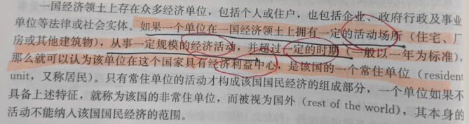
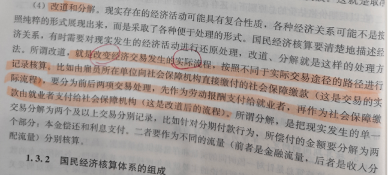
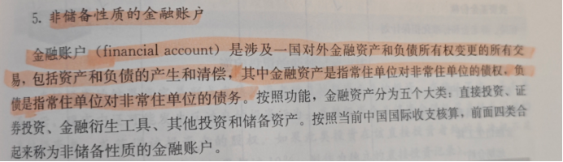
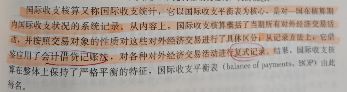
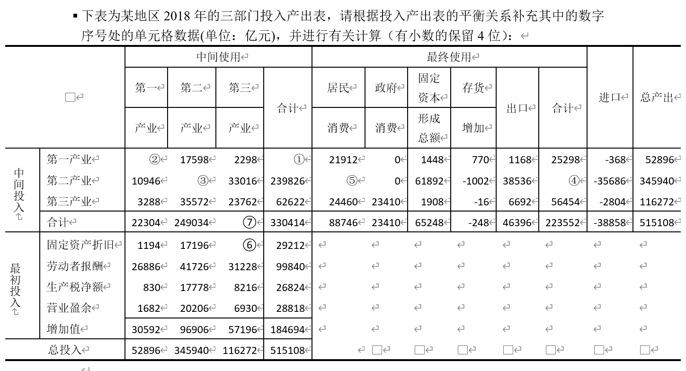

# 期末考试题型
1. 判断10个一个一分
2. 单选8个一个2分
3. 多选10个一个2分
4. 填空题14个一个一分
5. 简答题4个一个5分（简答的四道题目考的内容已经给出）
6. 综合两个一个7分，一个13分，其中第二个题目是投入产出（第三章）
# 期末考试范围
范围为1-7章（国民经济核算的主要内容）

# 简答题的四道题目
## 常住单位的概念 P12
如果一个单位在一国经济领土上拥有一定的活动场所（住宅、厂房或其他建筑物），从事一定规模的经济活动，并超过一定的时期（一般以一年为标准），那么就可以认为该单位在这个国家具有经济利益中心，是该国的一个常住单位。

## 改道的概念并举一个例子 P24

改道就是改变经济交易发生的实际流程，按照不同于实际交易途径的路径进行记录核算。比如由雇员所在单位向社会保障机构直接缴付的社会保障缴款（这是交易的实际流程），要分为前后两项交易处理，先作为劳动报酬支付给就业者，再作为社会保障缴款由就业者支付给社会保障机构（这是改道后的流程）。

## 金融账户概念P217

金融账户是涉及一国对外金融资产和负债所有权变更的所有交易，包括资产和负债的产生和清偿，其中金融资产是指常住单位对非常住单位的债券，负债是指常住单位对非常住单位的债务。

## 国际收支核算的含义、内容和记录方法P209

国际收支核算又称国际收支统计，它以国际收支平衡表为核心，是对一国在核算期内国际收支状况的系统记录。从内容上，国际收支核算概括了当期所有对外经济交易活动，并按照交易对象的性质对这些对外经济交易进行了具体区分；从记录方法上，它借鉴应应用了会计借贷记账法，对各种对外经济交易活动进行复式记录。

# 综合题
## 第一题 7分
## 第二题 13分
第二题考试题目类型参考下题
填下面的空并计算直接消耗系数$a_{12},$$a_{23}$（保留四位小数）以及2018年国内生产总值（GDP）

> [!Check]- 点击查看答案
> 答案：①27966 ②8070 ③195864 ④141800 ⑤42374 ⑥10822 ⑦59076
> 直接消耗系数 $a_{12}=0.0509$
> 直接消耗系数 $a_{23}=0.2840$
> 2018年国内生产总值（GDP）$=184694$

