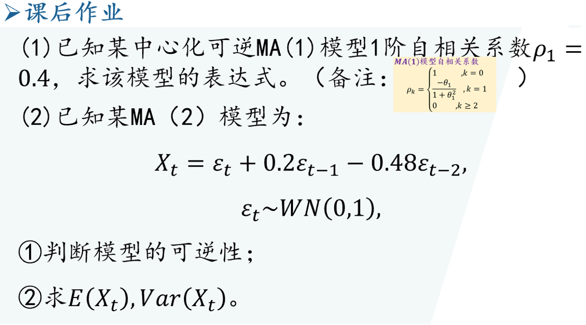
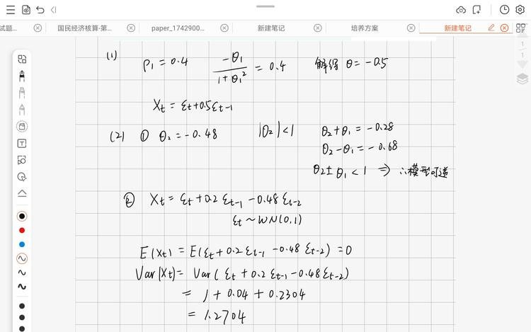
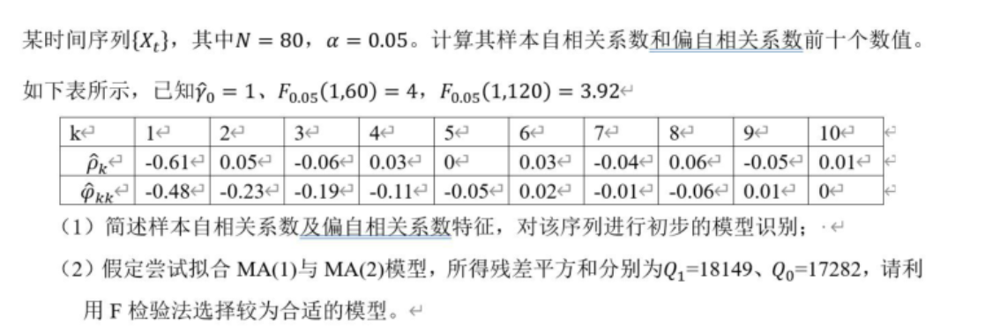
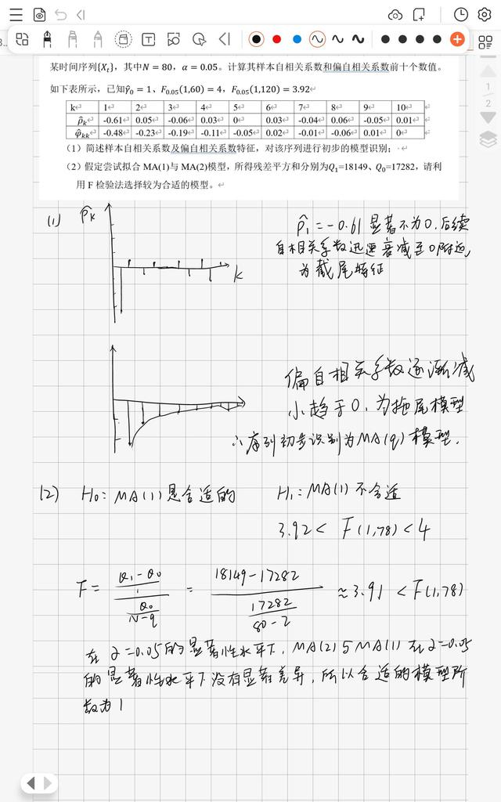

# 1-2章 课堂练习1
## 一. 单选题（共3题，42.8分）

### 1. (单选题)

  

- A.
    
      
    
- B.
    
      
    
- C.
    
      
    
- D.
    
      
    

> [!Check]- 点击查看答案
> 答案：C:;

_14.2_分

_AI讲解_

### 2. (单选题)

  

- A.
    
      
    
- B.
    
      
    
- C.
    
      
    
- D.
    
      
    

> [!Check]- 点击查看答案
> 答案：D:;

_14.3_分

_AI讲解_

### 3. (单选题)

  

- A.
    
      
    
- B.
    
      
    
- C.
    
      
    
- D.
    
      
    

> [!Check]- 点击查看答案
> 答案：B:;

_14.3_分

_AI讲解_

## 二. 填空题（共1题，14.3分）

### 4. (填空题)

  

_我的答案：_

_14.3_分

(1)

> [!Check]- 点击查看答案
> 答案：互为倒数

## 三. 判断题（共3题，42.9分）

### 5. (判断题)

白噪声序列是纯随机过程。  

- A. 对
- B. 错

> [!Check]- 点击查看答案
> 答案：对

_14.3_分

_AI讲解_

### 6. (判断题)

白噪声序列是宽平稳序列。  

- A. 对
- B. 错

> [!Check]- 点击查看答案
> 答案：对

_14.3_分

_AI讲解_

### 7. (判断题)

白噪声序列延迟K期（K不等于0）的自协方差值为0.  

- A. 对
- B. 错

> [!Check]- 点击查看答案
> 答案：对

# 第1-2章 课堂练习2
## 一. 判断题（共9题，47分）

### 1. (判断题)

时间序列数据的采集往往是按照一定的时间间隔∆来采样的，对于连续时间序列也采用这种方法进行离散化处理。

- A. 对
- B. 错

> [!Check]- 点击查看答案
> 答案：对

_5.2_分

_AI讲解_

### 2. (判断题)

时间序列的统计时序分析方法中的时域分析方法主要是从序列自相关的角度揭示时间序列的发展规律。

- A. 对
- B. 错

> [!Check]- 点击查看答案
> 答案：对

_5.2_分

_AI讲解_

### 3. (判断题)

观察值序列是随机时间序列的一个实现，我们可以通过它来推断总体的统计特性。

- A. 对
- B. 错

> [!Check]- 点击查看答案
> 答案：对

_5.2_分

_AI讲解_

### 4. (判断题)

描述性时序分析方法具有严格的数学理论基础，可以替代统计时序分析方法。

- A. 对
- B. 错

> [!Check]- 点击查看答案
> 答案：错

_5.2_分

_AI讲解_

### 5. (判断题)

确定性时间序列分析中，加法模型和乘法模型都可以用于分解趋势、季节、循环和随机成分。

- A. 对
- B. 错

> [!Check]- 点击查看答案
> 答案：对

_5.2_分

_AI讲解_

### 6. (判断题)

时域分析方法主要从频率角度分析时间序列，而频域分析方法主要从自相关角度分析。

- A. 对
- B. 错

> [!Check]- 点击查看答案
> 答案：错

_5.2_分

_AI讲解_

### 7. (判断题)

  

- A. 对
- B. 错

> [!Check]- 点击查看答案
> 答案：对

_5.2_分

_AI讲解_

### 8. (判断题)

  

- A. 对
- B. 错

> [!Check]- 点击查看答案
> 答案：对

_5.3_分

_AI讲解_

### 9. (判断题)

  

- A. 对
- B. 错

> [!Check]- 点击查看答案
> 答案：对

_5.3_分

_AI讲解_

## 二. 单选题（共10题，53分）

### 10. (单选题)

下列时间序列时域分析模型中，描述系统对过去自身状态记忆的模型是（  ）。

- A.
    
    MA模型
    
- B.
    
    AR模型
    
- C.
    
    ARMA模型
    
- D.
    
    协整模型
    

> [!Check]- 点击查看答案
> 答案：B:AR模型;

_5.3_分

_AI讲解_

### 11. (单选题)

下列时间序列时域分析模型中，描述系统对过去时刻进入系统的噪声记忆的模型是（  ）。

- A.
    
    MA模型
    
- B.
    
    AR模型
    
- C.
    
    ARMA模型
    
- D.
    
    协整模型
    

> [!Check]- 点击查看答案
> 答案：A:MA模型;

_5.3_分

_AI讲解_

### 12. (单选题)

下列时间序列时域分析模型中，描述系统对过去自身状态以及各时刻进入的噪声的记忆的模型是（  ）。

- A.
    
    MA模型
    
- B.
    
    AR模型
    
- C.
    
    ARMA模型
    
- D.
    
    协整模型
    

> [!Check]- 点击查看答案
> 答案：C:ARMA模型;

_5.3_分

_AI讲解_

### 13. (单选题)

下列模型形式中，是AR（n）模型形式的是（  ）。

- A.
    
      
    
- B.
    
      
    
- C.
    
      
    
- D.
    
      
    

> [!Check]- 点击查看答案
> 答案：A:;

_5.3_分

_AI讲解_

### 14. (单选题)

  

- A.
    
    方差
    
- B.
    
    自协方差
    
- C.
    
    自相关系数
    
- D.
    
    残差方差
    

> [!Check]- 点击查看答案
> 答案：B:自协方差;

_5.3_分

_AI讲解_

### 15. (单选题)

  

- A.
    
    方差
    
- B.
    
    自协方差
    
- C.
    
    自相关系数
    
- D.
    
    残差方差
    

> [!Check]- 点击查看答案
> 答案：C:自相关系数;

_5.3_分

_AI讲解_

### 16. (单选题)

严平稳是一种条件比较苛刻的平稳性定义，它认为只有当时间序列所有的（  ）都不会随着时间的推移而发生变化时，该序列才能被认为平稳。

- A.
    
    方差
    
- B.
    
    自协方差
    
- C.
    
    自相关系数
    
- D.
    
    统计性质
    

> [!Check]- 点击查看答案
> 答案：D:统计性质;

_5.3_分

_AI讲解_

### 17. (单选题)

  

- A.
    
    严平稳
    
- B.
    
    宽平稳
    
- C.
    
    自平稳
    
- D.
    
    非平稳
    

> [!Check]- 点击查看答案
> 答案：:宽平稳;

_5.3_分

_AI讲解_

### 18. (单选题)

对于一个纯随机过程来说，若其期望和方差都为常数，则称其为（  ）。

- A.
    
    布朗过程
    
- B.
    
    随机游走过程
    
- C.
    
    白噪声过程
    
- D.
    
    非平稳过程
    

> [!Check]- 点击查看答案
> 答案：C:白噪声过程;

_5.3_分

_AI讲解_

### 19. (单选题)

采用Q统计量针对时间序列进行纯随机性检验的原假设是（  ）。

- A.
    
    序列是一个纯随机序列
    
- B.
    
    序列不是一个纯随机序列
    
- C.
    
    序列是一个平稳序列
    
- D.
    
    序列不是一个平稳序列
    

> [!Check]- 点击查看答案
> 答案：A:序列是一个纯随机序列;

# 第3章 作业1

# 第3章 作业2

# 第3章课堂练习 (求MA(2)模型的均值和方差)

（1）E($X_t$)=( )

> [!Check]- 点击查看答案
> 答案：0

(2) $VAR ($$X_t$)=( )

> [!Check]- 点击查看答案
> 答案：1.65

# 第5章 作业（综合1 F检验

# 第10章 多元时间序列分析-模拟题（综合4）

题目：分析1978年至2014年国内生产总值（x）和居民消费支出（y）序列间的关系，相关结果如下：（其中，lnx、lny分别表示对数序列，dlnx、dlny分别表示lnx、lny的一阶差分序列，ECMt表示第t期的误差，$\alpha$取0.05））

（1）判断对数居民消费支出序列$\{\ln y_t\}$和对数国内生产总值$\{\ln x_t\}$序列之间是否具有协整关系，请写出具体检验过程和检验结果。
（2）若存在协整关系，请写出相应的误差修正模型，并对参数检验的结果进行解读。

 

 

 

 

 

（1）判断对数居民消费支出序列$\{\ln y_t\}$和对数国内生产总值$\{\ln x_t\}$序列之间是否具有协整关系，请写出具体检验过程和检验结果。

**答题要点：**

**A.单位根检验**

第一，列出单位根检验原假设和备择假设的一般表述。

原假设：

备择假设：

第二，结果软件输出结果图，判断lnx、lny以及dlnx、dlny序列的平稳性。

**B、采用最小二乘法建立变量lny对lnx的回归模型，根据软件输出图列出回归方程表达式。**

**C、对模型残差进行平稳性检验**

原假设：

备择假设： 

结论及依据（是否存在协整关系）：

（2）若存在协整关系，请写出相应的误差修正模型，并对参数检验的结果进行解读。

**A.列出误差修正模型表达式**

**B、对模型系数显著性加以解释，对系数加以解释。**