# 期末考试题型
1. 单选5个一个4分（20分）
2. 填空5个一个4分（20分）
3. 简答4个一个5分（20分）
4. 综合1（第5章 F检验法）作业题
5. 综合2 （第7章 AR(p)模型预测）6分
6. 综合3 （第3章 判断模型平稳性）作业1
7. 综合4 （第10章 多元时间序列分析）实验7

# 简答的4个题目
## 时域分析方法概念（P8-9)

时域分析方法的基本思想是源于事件的发展通常都具有一定的惯性，这种惯性使用统计语言来描述即为序列之间的相关关系，而这种相关关系具有一定的统计性质，时域分析的重点就是寻找这种统计规律，并且拟合适当的数学模型来描述这种规律，进而利用这个拟合模型来预测序列未来的走势。

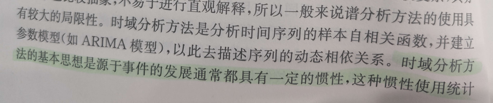

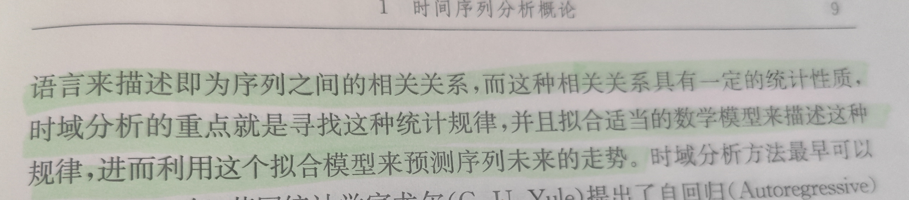

## 移动平均模型概念（MA）（P69)

有些情况下，序列{$X_t$}的记忆是关于过去外部干扰的记忆。在这种情况下，{$X_t$}可以表示成过去干扰值和现在干扰值的线性组合，此类模型常称为序列{$X_t$}的移动平均模型。

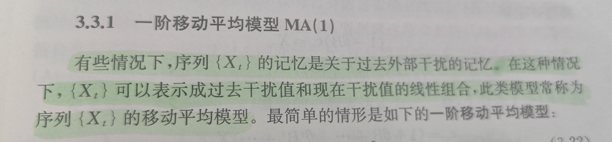
## 自回归移动平均模型（ARMA）（P71)

如果序列{$X_t$}的当前值不仅与自身的过去值有关，还与其以前进入系统的外部干扰存在一定依存关系，则在用模型刻画这种动态特征时，模型中既包括自身的滞后项，也包括过去的外部干扰，这种模型叫作自回归移动平均模型，即 ARMA(p,q)模型。

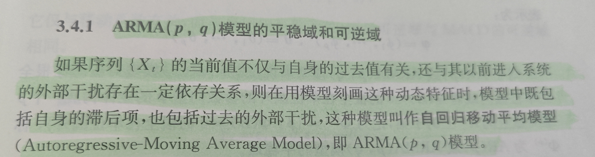

## ARIMA模型概念（P183)

ARIMA模型的实质就是差分运算与ARMA模型的组合。这一关系意义重大，这说明任何非平稳序列只要通过适当阶数的差分运算实现差分后平稳，就可以对差分后序列进行ARMA模型拟合了。

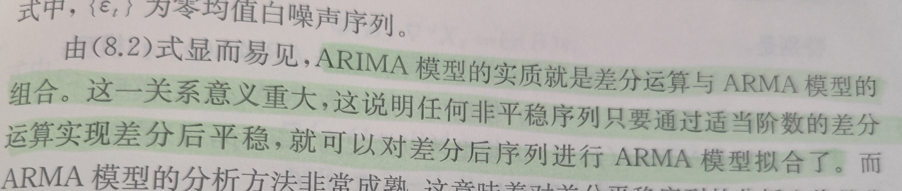

# 综合题
## 第5章 F检验法
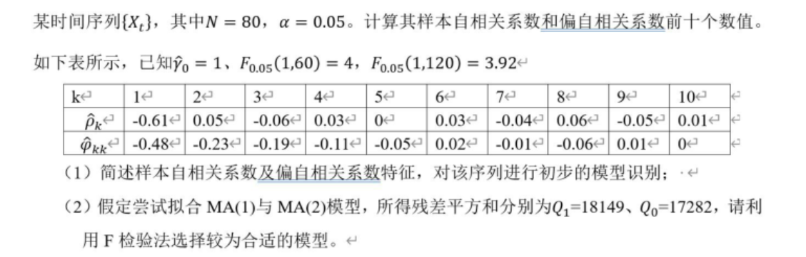

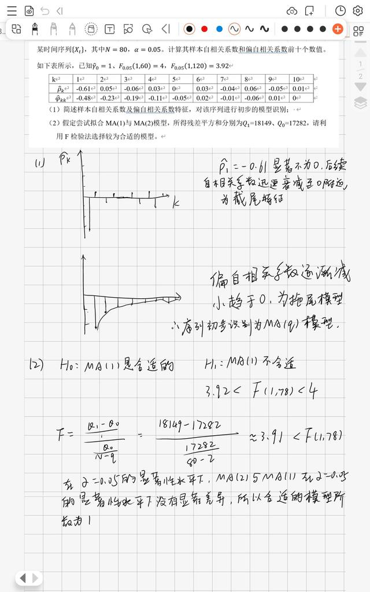
## 第7章 AR(p)模型预测（6分）

## 第3章 判断模型平稳性（作业1）
### 作业1 

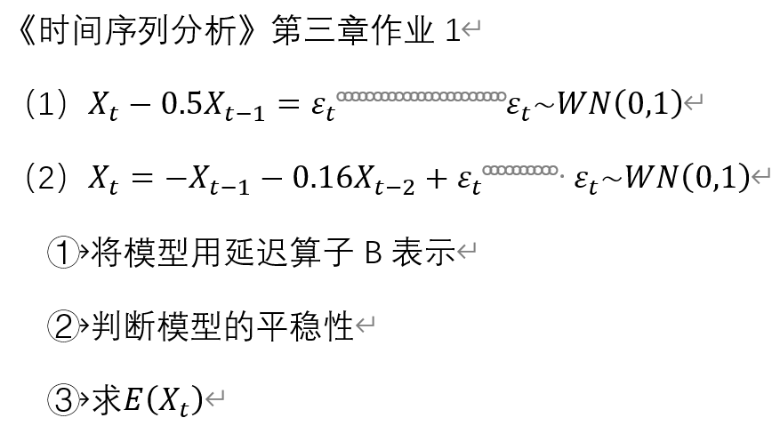
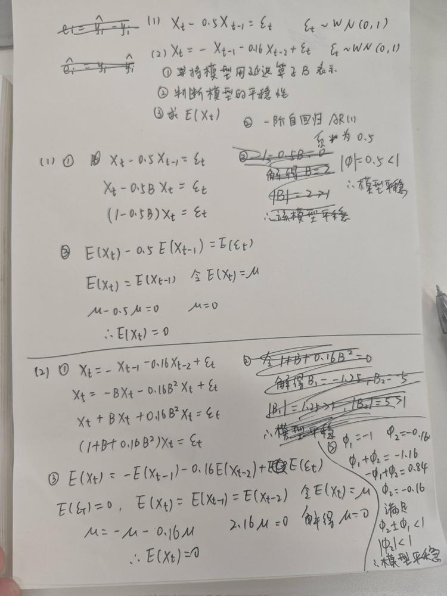

### 作业2
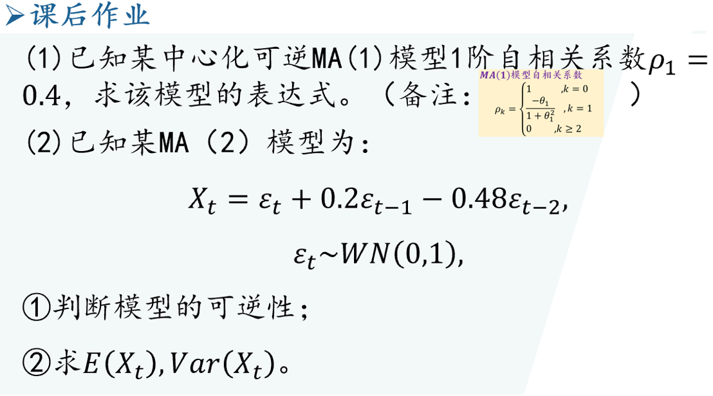

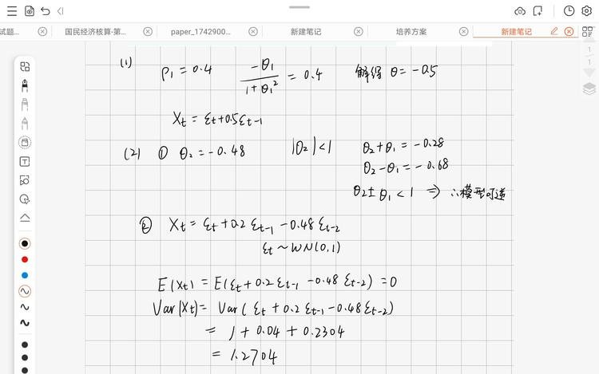
## 第10章 多元时间序列分析（实验7）

1. 原假设：原序列存在单位根（原序列为非平稳序列）
	备择假设：原序列不存在单位根（原序列为平稳序列）
2. 根据输出结果判断lnx、lny以及dlnx、dlny（都写）判断平稳还是非平稳
3. 差分序列平稳，非差分序列不平稳
4. 求lny对lnx的回归模型（列出回归模型）
5. 对残差进行平稳性检验
	原假设：残差序列存在单位根
	备择假设：残差序列不存在单位根
6. 结论与依据（判断是否存在协整关系）
7. 存在协整关系，写出相应的误差修正模型，并对参数检验结果进行解读
	1. 列出误差修正模型表达式
	2. 对模型系数显著性加以解释，对系数加以解释

